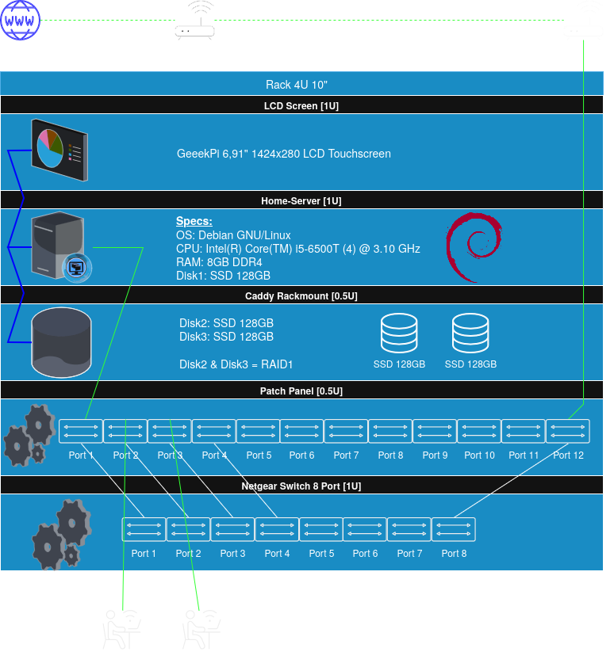

# **🏠 Home-Server Stack**

[](https://www.debian.org)
[](./stack/)

**[Selfhosted Apps](#selfhosted-apps)** • **[Scripts](#scripts)**

A self-hosted home server setup running on Debian with Podman. \
I mainly use this for Taskmanagement, Backups and DNS Adblock.

---

<div align="center">

</div>

---

## Selfhosted Apps
| Service | Description |
|--------|-------------|
| 🧠 Glance | Dashboard |
| ⛔️ AdGuard-Home | DNS Adblock |
| 🔒 Vaultwarden | Password Manager |
| ✅ Vikunja | Task Management |
| 💰 Wallos | Subscription tracker |
| 📁 Filebrowser-Quantum | File Management |
| 🌐 Cloudflared | Cloudflare Tunnel |
| ⛓️ Caddy | Reverse-Proxy |
| 🔔 Gotify | Notifications |

## Scripts
| Script | Purpose |
|--------|---------|
| logging.sh | Universal logger |
| cleanup.sh | System cleanup |
| backup.sh | Backups (private) |
| check_podman.sh | Containers uptime check |
| check_smartctl.sh | Check disks health |
| send_gotify.sh | Send messages to myself via Gotify (private) |

I also use [Server-VibeCheck](https://github.com/Knuspii/Server-VibeCheck)

---

## ⚙️ System Setup (Debian)
### Base packages I use
```bash
sudo apt install htop ssh rsync ncdu curl tree jq smartmontools fastfetch at mdadm
```

## 📊 Notes
- Secrets are stored in `.env` (not committed obviously)
- Rootless by default — containers run as a regular user, not as root.
- Better isolation — no central Docker daemon running with root privileges.
- Easy to automate — containers are started through simple shell scripts.

---

## 🧠 Author
Home server stack by Knuspii
